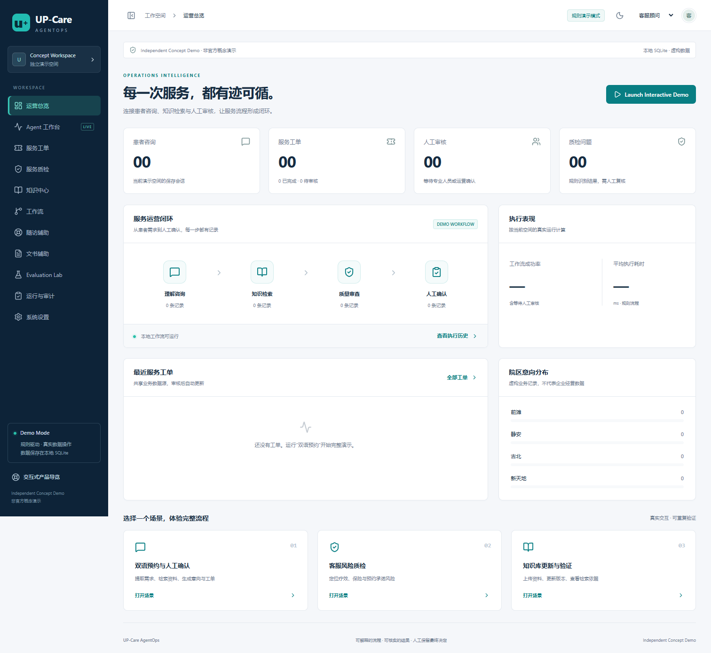
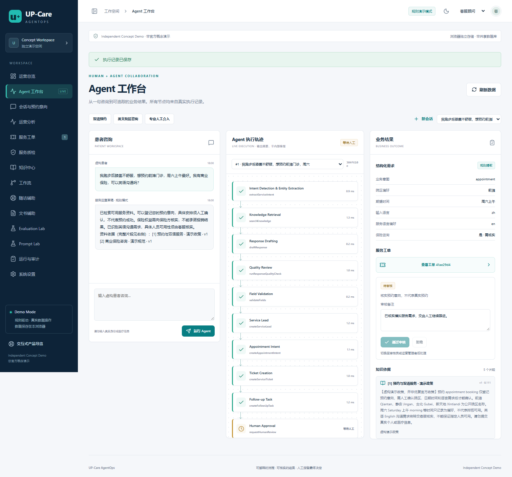
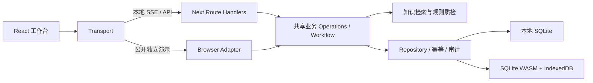

# UP-Care AgentOps

**康复医疗 AI 智能运营与服务质量管理平台 · Independent Concept Demo / 非官方概念演示**

An independently built clinic operations demo that connects bilingual service inquiries, evidence retrieval, communication quality checks, appointment intent, human review and traceable business outcomes. All patient records are fictional. This project is not affiliated with or endorsed by UP Clinic.

从一句虚构患者咨询开始，查看实际工作流节点、知识来源、预约意向与服务工单，切换演示角色完成审核，再核对运营数据。页面上的执行状态、耗时和统计来自实际操作。

- GitHub：[wuchan1870422-byte/up-care-agentops](https://github.com/wuchan1870422-byte/up-care-agentops)
- Live Demo：[up-care-agentops.vercel.app](https://up-care-agentops.vercel.app)（公开访问，浏览器独立保存虚构数据）
- 完整需求：[MASTER_SPEC](docs/MASTER_SPEC.md)；接续开发：[PROJECT_STATE](PROJECT_STATE.md) 与 [TASKS](TASKS.md)。




## 可操作的功能

| 模块 | 当前实现 |
|---|---|
| AI Command Center | 中英咨询、多轮补问、真实 SSE 节点流、执行轨迹、工单与引用联动 |
| Service Agent | 规则意图与字段提取，语言偏好、人工转接、受控业务工具、幂等与失败重试 |
| Service Quality | 疗效、医学判断、保险、预约、敏感信息及不当表达检查，TXT/JSON 导入最多 20 条、人工复核、报告下载 |
| Knowledge Hub | TXT/Markdown 上传，本地模式支持文本 PDF；分块、关键词排序、引用、版本、失效及权限 |
| Workflow Studio | 五种预定义业务流程入口、咨询节点回放；没有冒充可用的任意拖拽编辑器 |
| CRM & Tasks | 虚构联系人、线索、预约意向、工单、负责人、备注、状态流转、跟进任务、CSV |
| Follow-up | 多条记录摘录、待核实事项、人工跟进任务，明确不进行临床判断 |
| Documentation | 保守 SOAP 草稿：S 原文，O 未提供，A/P 留给医疗人员；专业审核 |
| Analytics | 真实记录汇总、日期/院区筛选、趋势、意图与风险分布、处理耗时 |
| Evaluation & Audit | 77 条独立虚构评测案例、结果历史、工具审计、运行 ID 与节点耗时 |
| Prompt Lab | 不可变模板版本、6 条模板规则检查、实际风险与版本差异；未调用 LLM |
| Integration Sandbox | 当前空间的 Mock Appointment 查询、幂等 Mock CRM 同步及审计 |

## 运行模式与诚信边界

当前运行的是 **Rule-Based Demo**，不是已接入大模型的 Real AI。没有模型调用费用，也没有虚构模型名称、推理内容或效果指标。

1. `/` 本地运行使用 Node SQLite 文件数据库；服务端检查角色、会话与工作空间。
2. `/demo` 和 Vercel 部署使用 SQLite WASM + IndexedDB。浏览器关闭或刷新后数据仍可恢复，但数据不跨设备共享；清除站点数据会清除演示内容。浏览器模式的角色是演示行为，不能视为可信身份认证。
3. Coze 适配器已实现超时和错误处理，尚未配置或验证外部调用。Embedding、语音、真实 CRM、真实排班和共享 PostgreSQL 尚未连接。
4. 预约意向不代表预约成功；所有回复均为草稿，不发送真实短信、邮件或医疗建议。

完整差距见 [Feature Status](docs/FEATURE_STATUS.md)，不将未完成能力包装为可用功能。

## 本地运行

要求 Node.js **24.x**、npm 与 Git；不需要付费 API Key。

```bash
npm ci
npm run db:init
npm run dev
```

打开 [本地应用](http://127.0.0.1:3000)；浏览器独立演示在 [本地 /demo](http://127.0.0.1:3000/demo)。第一次访问创建独立演示空间并载入公开背景摘要和虚构业务规范。

```bash
npm run typecheck
npm run lint
npm test
npm run evaluate
npm run build
npm run test:e2e
```

Windows E2E 默认使用已安装的 Microsoft Edge；其他环境使用 Playwright Chromium。Linux 首次运行：`npx playwright install --with-deps chromium`。生产运行：`npm run build` 后执行 `npm start`。

环境变量示例在 [.env.example](.env.example)。`.env.local`、数据库、认证目录及测试运行资料均被 Git 忽略。不要把 API Key 发到聊天或写入客户端代码。

## 架构与技术取舍

Next.js 16.4、React 19、TypeScript、Zod、Lucide、Node SQLite / sql.js、IndexedDB、Vitest、Playwright、ESLint。采用自建 CSS Token 与语义化 HTML 节点图，避免为仅展示状态的图引入无效编辑能力。



现有仓库原本使用 SQLite。本次保留并验证该实现，通过可替换 Repository 连接浏览器演示。生产级 PostgreSQL、真正的用户认证、后台队列及第三方连接仍需后续实现与验证。

## 业务依据与文档

优复公开培训回顾提及沟通质检、随访、问答和跨部门知识协作；员工访谈描述跨语言及患者表达理解的困难。这里只据公开资料设计独立作品，不主张知道企业内部 KPI 或已获得接口授权。[业务调研](docs/BUSINESS_RESEARCH.md)

- [产品需求](docs/PRD.md) · [岗位能力映射](JD_REQUIREMENTS.md)
- [架构](docs/ARCHITECTURE.md) · [数据模型](docs/DATABASE_SCHEMA.md) · [API](docs/API.md)
- [Agent 与工作流](docs/AGENT_WORKFLOWS.md) · [RAG](docs/RAG_DESIGN.md) · [Coze 复现](docs/COZE_WORKFLOW.md)
- [安全边界](docs/SECURITY_SAFETY.md) · [测试报告](docs/TEST_REPORT.md) · [评测报告](docs/EVALUATION_REPORT.md)
- [部署指南](docs/DEPLOYMENT.md) · [演示指南](docs/DEMO_GUIDE.md) · [功能状态](docs/FEATURE_STATUS.md)

本作品使用独立视觉标识，不代表优复官方产品，不提供诊疗服务。
