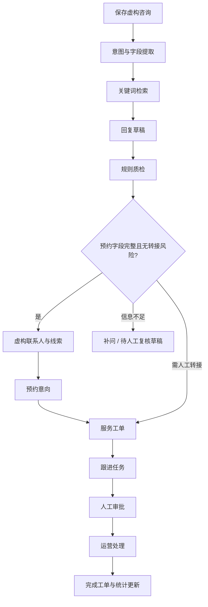

# Agent 工作流与回放

每个节点保存唯一 ID、tool、真实起止时间、耗时、输入摘要、输出或错误。节点详情是执行记录，不是模型的私有思维链。人工等待耗时与自动执行耗时分别记录。

默认最多 12 个自动节点、15 秒执行预算。规则执行为同步函数，预算在节点边界检查；不宣称可中断任意卡死的同步任务。工作流失败可重试整个流程，重试沿用初次 Run 的业务写入幂等键。部分创建完成后不会再次创建同一业务对象。

| 工作流 | 实际入口 | 记录 |
|---|---|---|
| A 咨询 | Agent 工作台 | Run、消息、质量检查 |
| B 预约 | 完整预约咨询 | 线索、意向、工单、任务、审核 |
| C 随访 | 随访辅助 | 原文摘录、未解决条目、工单及任务 |
| D 批量质检 | 服务质检 | 逐条 QualityReview 与分类统计 |
| E 知识更新 | 知识中心 | 文档版本、分块、索引审计 |

仅咨询流程具备统一的逐节点轨迹。其他流程目前通过业务记录与操作审计追踪；任意图形编排、断点级重放及持久化后台队列尚未实现。
