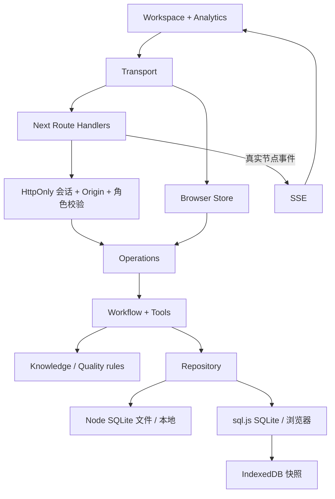

# 架构与设计决策

## 共享业务层

`workspace.tsx` 提供交互；`transport.ts` 分发到本地 API 或浏览器适配器；`operations.ts` 执行业务；`workflow.ts` 编排咨询；`tools.ts` 校验工具；`repository.ts` 统一数据访问；`rules.ts` 和 `knowledge.ts` 执行确定性处理。

## 决策记录

- **保留原工程**：没有重建目录或覆盖初始成果；原代码保存在首个基线提交。
- **SQLite 继续使用**：继承了同步 SQLite Repository；通过参数化 SQL、事务、唯一幂等键和工作空间过滤实现本地闭环。尚未实现 PostgreSQL 驱动，不能将该设计称为完整生产级多租户后端。
- **浏览器云演示**：Vercel 不使用进程内存或 `/tmp` 数据库。WASM SQLite 在浏览器执行，完成操作后写入 IndexedDB。Web Locks 串行化跨标签页写入；每次操作加载最新快照，保存成功后才返回。
- **失败恢复**：重试保留原始输入和会话，以最初 Run ID 派生写入幂等键；部分完成后再试不重复创建联系人、线索、意向、工单或跟进任务。失败节点保留真实错误与耗时。
- **有限编排**：五个预定义入口真正操作业务对象，咨询流程有完整节点记录；其余流程通过业务记录和审计追踪，尚无通用图形编排引擎。
- **无模拟模型**：规则输出标明 Demo；无模型密钥时不伪造模型调用、token、成本或推理内容。
- **UI**：独立 CSS Token、深浅主题、响应式三栏和可点击节点。静态节点布局用于实际执行图，没有无效的拖拽编辑按钮。

## 生产化剩余工作

PostgreSQL 规范化关系、托管备份、真正的用户认证、队列与分布式锁、全局请求限速、真实模型和向量检索、可审计的模型成本及正式数据保留策略。演示空间限额不能替代互联网生产限流。
