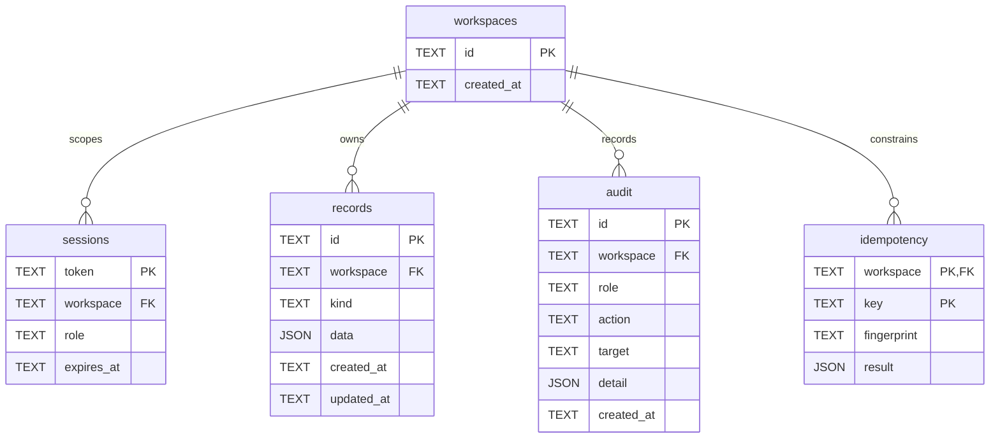

# 数据模型

实际迁移位于 `src/lib/database-schema.ts` 和本地初始化 `src/lib/db.ts`。SQLite 驱动启用外键、WAL、busy timeout；JSON 内容受 `json_valid` 检查。业务对象共享 `records` 表，类型由 TypeScript 与 Zod 管理。

| 业务实体 | 当前存储 |
|---|---|
| Clinic | rules.ts 中四个公开院区与来源；不是排班表 |
| User / Role | sessions 的演示角色；无真实用户账号表 |
| Contact | records.kind=customer；系统生成虚构昵称 |
| Conversation / Message | conversation 的消息数组，时间与角色 |
| KnowledgeDocument / Chunk | document 的正文、分块数组、来源、可见性、历史版本 |
| ServiceLead | lead；关联 contactId、conversationId 和意图 |
| AppointmentIntent | appointment；院区、时间、语言偏好；unconfirmed |
| ServiceTicket | ticket；关联 conversationId、runId，状态、负责人、备注 |
| FollowUpTask | followup；关联 ticketId、记录摘录、待核实事项与状态 |
| ReviewDecision | approval；关联目标，审核状态、角色、备注 |
| QualityReview | quality；原文、风险、建议、引用及人工复核 |
| AgentRun / AgentStep | run；节点数组含时间、输入输出和状态 |
| WorkflowDefinition | 版本控制中的五个预定义流程 |
| EvaluationCase / Run | 代码中的 77 个案例；evaluation 保存每次实际结果 |
| PromptTemplate | prompt；不可变 version、parentId、模板及变更说明 |
| TemplateEvaluation | promptEvaluation；关联 promptId/version、数据集、六案例实际输出、风险、耗时；非模型评测 |
| IntegrationRecord | integration；虚构 leadId、Mock CRM 外部编号、synced_locally；无外部发送 |
| AuditLog | audit 表，按空间查询 |

索引：records(workspace,kind,created_at)、audit(workspace,created_at)、idempotency(workspace,key) 唯一约束。关联对象必须在当前工作空间中存在；业务 JSON 内的引用不是数据库外键，依靠 Service 校验。因此这是已验证的演示模型，不应宣称已完成 Master Spec 的规范化 PostgreSQL 模型。

工单：pending → approved → in_progress → completed；pending 可被 rejected。人工审批不等于真实预约确认。所有时间持久化为 ISO UTC；趋势按 UTC 日期聚合，UI 的时间标签明确说明。
